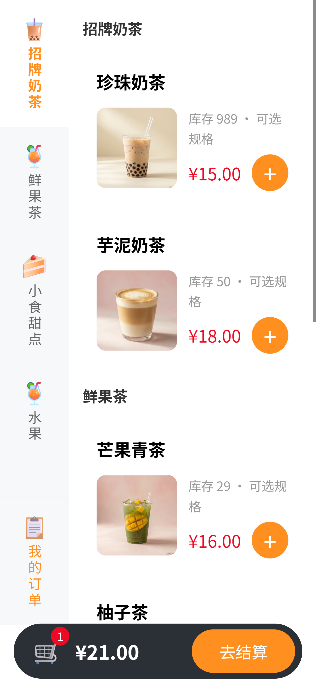
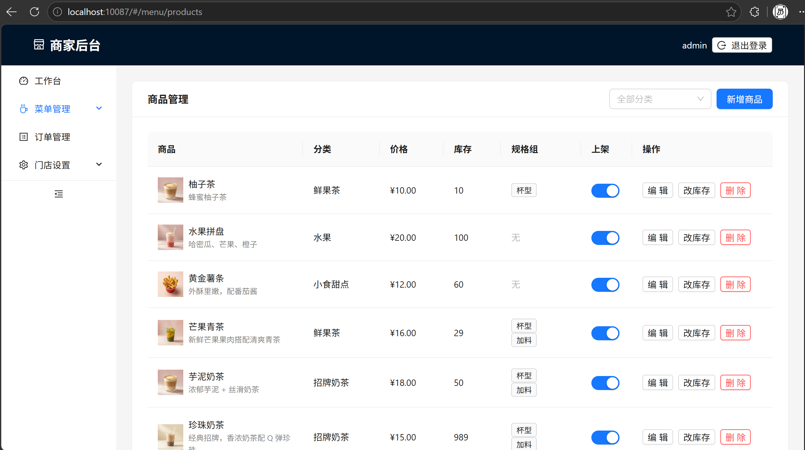
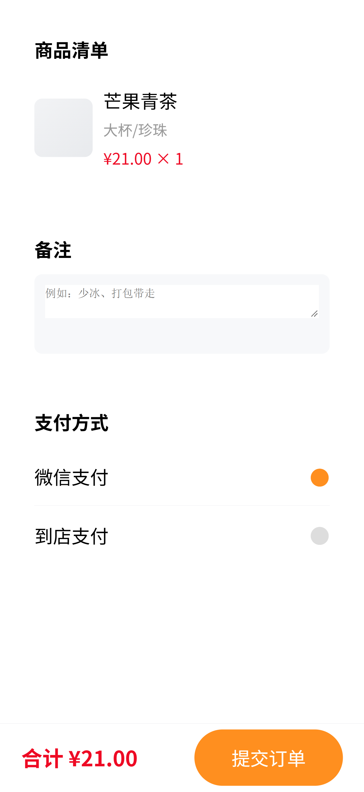
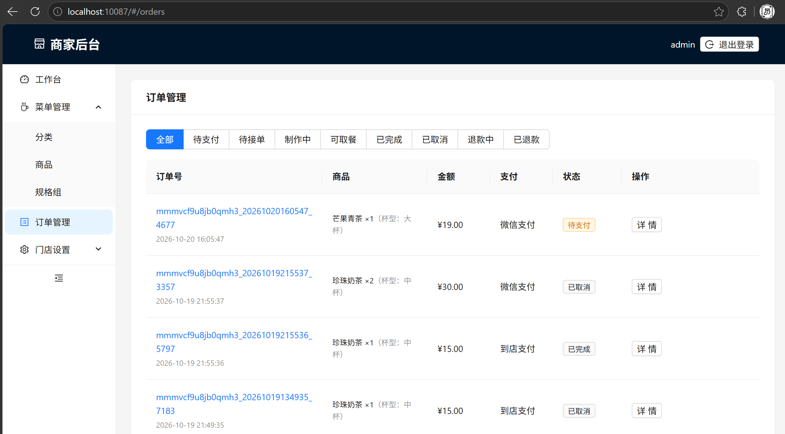

# OrderApp

[](./LICENSE)
[](https://nodejs.org)
[](https://nestjs.com)
[](#测试)

单店自提点餐可复用模板（微信小程序 + 商家后台 + NestJS 服务端）。

> 第一版聚焦「远程下单 · 到店自提」场景，按多端标准编写，为后续支付宝/抖音端预留适配层。详细需求见 [`specs/`](./specs)。

## 项目状态

**v0.1（P0）已交付** —— 自提点餐主链路（扫码进店 → 菜单 → 下单支付 → 接单出餐 → 取餐闭环）全部可用，支持单机 docker-compose 部署（见[部署手册](./docs/deployment.md)）。当前进入 P1 规划阶段。

## 功能亮点

顾客端菜单点餐与商家后台管理一览（截图取自本地演示环境，原图见 [`docs/img/`](./docs/img)）：

<table>
  <tr>
    <td align="center" width="50%">
      <br/>
      <sub><b>顾客端 · 菜单浏览</b>：分类侧栏双向联动、商品图、规格入口、底部购物车</sub>
    </td>
    <td align="center" width="50%">
      <br/>
      <sub><b>商家后台 · 商品管理</b>：预设图片选择、上下架、改库存、规格组绑定</sub>
    </td>
  </tr>
  <tr>
    <td align="center">
      <br/>
      <sub><b>顾客端 · 确认订单</b>：备注、微信支付 / 到店支付</sub>
    </td>
    <td align="center">
      <br/>
      <sub><b>商家后台 · 订单管理</b>：按状态分页签筛选，接单 / 出餐 / 退款流转</sub>
    </td>
  </tr>
</table>

## 架构总览

```
apps/miniapp   微信小程序（顾客端）
apps/admin     商家后台（Web）
server/        NestJS 服务端（REST + WebSocket + 微信支付回调）
  ├─ MySQL 8   业务数据持久化（Prisma ORM）
  └─ Redis 7   菜单缓存、库存预扣、WebSocket 广播
```

Monorepo 基于 npm workspaces（`apps/*` + `server`），本地依赖通过 `docker-compose` 拉起 MySQL 与 Redis。

## Tech Stack

### 服务端（`server/`）

| 类别 | 选型 | 用途 |
|---|---|---|
| 运行时 | Node.js ≥ 20 + TypeScript 5.6 | 类型安全 + 生态成熟 |
| 框架 | NestJS 10 | 模块化 DI、装饰器风格 Controller/Service |
| ORM | Prisma 5 | schema 即真相源，迁移与类型生成 |
| 数据库 | MySQL 8.0（utf8mb4） | 业务主数据存储 |
| 缓存 / 预扣 | Redis 7 + ioredis | 菜单缓存、库存原子 DECR/INCR、WS 广播 |
| 实时通信 | `@nestjs/platform-ws` + `ws` | 订单状态推送（< 3s） |
| 支付 | `wechatpay-node-v3` | 微信 JSAPI 下单、回调验签、幂等 |
| 认证 | `@nestjs/jwt` + `passport-jwt` + `bcrypt` | 顾客 openid token / 商家 admin token |
| 校验 | `class-validator` + `class-transformer` | DTO 入参校验 |
| 事件总线 | `@nestjs/event-emitter` | 模块间解耦（支付回调 → 订单状态机） |
| 测试 | Jest + ts-jest | 单元与集成测试（`server/src/**/*.spec.ts`） |
| 构建 | `nest build` + `tsc --noEmit` | CI 流水线类型检查 + 编译 |

### 前端

- **小程序端**（`apps/miniapp/`）：Taro 4 + React 18，一套代码编译到微信小程序（`dev:weapp`）与 H5（`dev:h5`）。通过 scene 参数解析门店入口。
- **商家后台**（`apps/admin/`）：React 18 + Vite 4 + Ant Design 5，管理菜单、订单、营业设置与打印机。

### 基础设施

- 容器编排：`docker-compose.yml`（MySQL 8 + Redis 7，含健康检查与持久卷）。
- 配置：`.env.example`（DB / Redis / JWT / 微信商户号等），本地开发实际读取 `server/.env`。
- 数据库结构：`server/prisma/migrations/` 已提交初始迁移，部署用 `prisma migrate deploy`（详见部署手册）。

## 功能总览

### 已实现（v0.1 / P0）

| 功能 | 说明 |
|---|---|
| 入口识别 | 扫码 / 链接解析 scene，自动定位门店；打烊、非法入口友好提示 |
| 菜单浏览 | 分类展示、售罄置灰、上下架过滤，首屏加载快 |
| 规格选择 | 单选 / 多选规格、必选可选、加价实时计算 |
| 购物车 | 增减、删除、订单备注 |
| 下单与支付 | 下单锁库存；微信支付（含沙箱模拟）与到店支付两种方式 |
| 订单状态 | 待支付 → 待接单 → 制作中 → 待取餐 → 已完成，支持取消 / 退款分支 |
| 商家端订单管理 | 新单实时提醒、按状态筛选、接单 / 出餐 / 取消、小票打印 |
| 菜单管理 | 分类、商品、规格的维护与上下架、库存调整 |
| 商品图片 | 服务端托管预设图集，商家后台缩略图点选，顾客端全链路展示（含订单快照） |
| 营业设置 | 营业 / 打烊切换、门店公告 |
| 实时同步 | 订单状态变化通过 WebSocket 推送，顾客端免刷新 |

> 各功能的详细需求与验收用例见 [`specs/01-requirements.md`](./specs/01-requirements.md)，接口契约见 [`specs/03-api.md`](./specs/03-api.md)。

### 后续规划

- **P1**：堂食桌台、加菜催单、热销榜与搜索、营业数据看板等，详见 [`specs/01-requirements.md`](./specs/01-requirements.md#32-p1第二版)。
- **P2**：会员/积分/优惠券、多门店、抖音 / 支付宝端。

## 快速开始

### 1. 启动依赖（MySQL + Redis）

```powershell
docker compose up -d
docker compose ps        # 等到 mysql / redis 都是 healthy
```

### 2. 安装依赖并配置环境变量

```powershell
npm install
copy .env.example server\.env     # Windows；macOS/Linux 用 cp .env.example server/.env
```

`server/.env` 里必须改的只有 `JWT_SECRET`（≥32 位随机串）；微信相关变量留空即可，留空时自动走「模拟支付」沙箱。

### 3. 初始化数据库 + 演示数据

```powershell
npm run migrate -w server    # prisma migrate dev（首次会生成 client）
npm run seed                 # 一键注入示例门店 + 菜单 + admin 账号
```

`seed` 可重复执行：库里已有门店时直接跳过并提示重置命令，不会注入第二份演示数据。执行完会打印门店 ID 与扫码 `scene`，后面顾客端进店要用。

### 4. 三端启动

| 端 | 命令（仓库根目录） | 地址 |
|---|---|---|
| 服务端 | `npm run dev` | `http://localhost:3000`，API 前缀 `/api/v1`，WebSocket `/ws` |
| 商家后台 | `npm run admin:dev` | `http://localhost:10087` |
| 顾客端（H5 调试） | `npm run miniapp:dev:h5` | `http://localhost:10086` |

两个前端 dev server 都配置了 `/api` 代理指向 `http://localhost:3000`，无需处理跨域；顾客端 WebSocket 直连 `ws://localhost:3000/ws`（见 `apps/miniapp/src/services/request.ts`）。

顾客端进店链接（`scene` 用 seed 打印的 base64 值，形如 `bWVyY2hhbnRfaWQ9...`）：

```
http://localhost:10086/#/pages/entry/index?scene=<seed 打印的 base64>
```

> `scene` 必须是 base64 形态：H5 的 hash 路由会把裸 `merchant_id=xxx` 里的 `=` 当作查询分隔符截断，导致解析失败。真实微信桌码生成的也是 base64 scene，行为一致。

服务端 WebSocket 端点 `/ws`，客户端通过 `subscribe:customer { openid }` / `subscribe:merchant { merchantId }` 加入对应房间。

## 默认账号

seed 注入的演示数据，仅用于本地联调与体验版：

| 角色 | 入口 | 账号 | 说明 |
|---|---|---|---|
| 商家 | `http://localhost:10087` | `admin` / `admin123` | 单门店后台账号，密码 bcrypt 存储 |
| 顾客 | `http://localhost:10086` | 无需注册 | 本地生成 `openid` 存 localStorage，扫 scene 即进店 |

演示内容：示例奶茶店 1 家（默认营业、开启到店支付）、3 个分类、4 个商品（含 1 个售罄，均带预设商品图）、2 个规格组（杯型必选 / 加料可选）。

## 主链路验收（人肉步骤）

跑通「扫码 → 菜单 → 加购 → 下单 → 支付 → 商家接单 → 出餐 → 顾客确认取餐」：

1. **进店**：浏览器打开上面的顾客端进店链接，应看到菜单首屏（分类、价格、规格）。
2. **加购**：选规格加入购物车，改数量、填备注。
3. **下单**：进「确认订单」，选「微信支付」提交。
4. **支付**：弹出「模拟支付（沙箱）」→ 点「支付成功」。
   > 沙箱只推进前端流程，后端支付状态需微信回调确认。此时在另一个终端手动触发回调：
   > ```powershell
   > curl -X POST http://localhost:3000/api/v1/payment/wx-notify -H "Content-Type: application/json" -d "{\"out_trade_no\":\"<订单号>\",\"transaction_id\":\"42000000000000000002\",\"result_code\":\"SUCCESS\"}"
   > ```
   > 订单号在顾客端订单详情或后台「待支付」列表可见。回调后订单进入「待接单」。
5. **到店支付分支**（可选）：下单时选「到店支付」，订单停在「待支付」；商家后台「订单管理 → 待支付」标签页点**确认收款**即可推进，无需回调。
6. **商家接单**：后台应保持 WebSocket 连接——支付成功后右下角弹出「收到新订单」。点「接单」→ 状态变「制作中」，可再点「出餐」或「打印小票」。
7. **顾客侧实时同步**：顾客端订单详情页无需刷新，商家接单后跳到「制作中」、出餐后跳到「待取餐」（`order:status` 推送，实测 < 3s）。
8. **确认取餐**：顾客端点「确认取餐」→ 订单变「已完成」，链路闭环。
9. **库存校验**：全程回后台「菜单管理」看商品库存——下单即减、商家取消即回补（Redis 预扣与 DB 同步归还）。

上述每一步的接口契约见 [`specs/03-api.md`](./specs/03-api.md)；服务端行为由 `server/src/**/*.spec.ts` 覆盖（当前 119 例）。

## 体验版小程序

1. `npm run miniapp:build` 产出 `apps/miniapp/dist/weapp`。
2. 用微信开发者工具导入该目录，AppID 填自己的小程序 AppID（`.env` 的 `WX_APPID` 需一致）。
3. 开发者工具「上传」→ 微信公众平台「版本管理」设为体验版 → 添加体验成员后扫码。
4. **进入门店**：微信扫桌码要求 scene 参数，正式做法是在公众平台生成「小程序码（带 scene 参数）」，scene 值即 seed 打印的 `bWVyY2hhbnRfaWQ9...`；开发期也可以直接用「编译模式 → 启动页面 `pages/entry/index` + 启动参数 `scene=<base64>`」模拟。

> 二维码本身依赖真实 AppID 与已认证主体，无法随仓库分发；体验版二维码请在拿到 AppID 后由开发者工具生成。

## 测试

```powershell
npm run ci -w server   # tsc 类型检查 + nest build + jest
```

## 文档索引

| 文档 | 内容 |
|---|---|
| [`specs/01-requirements.md`](./specs/01-requirements.md) | 需求规格与 P0/P1/P2 分级、验收用例、非功能指标 |
| [`specs/02-domain.md`](./specs/02-domain.md) | 领域对象、关系图、订单状态机、库存机制 |
| [`specs/03-api.md`](./specs/03-api.md) | REST 接口契约、错误码、WebSocket 事件 |
| [`specs/04-data.md`](./specs/04-data.md) | 表结构、索引、ER 关系、关键设计说明 |
| [`docs/deployment.md`](./docs/deployment.md) | 单机 docker-compose 部署手册：环境变量清单、升级/备份/回滚、故障排查、安全检查清单 |

## License

[MIT](./LICENSE)，详见 [`LICENSE`](./LICENSE)。
